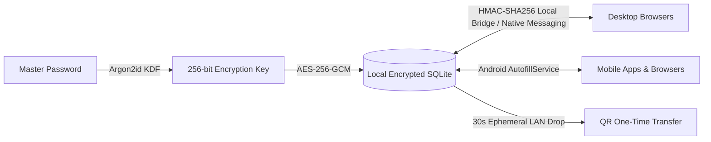

<pre>
██╗   ██╗██╗   ██╗██╗      ██████╗ 
██║   ██║╚██╗ ██╔╝██║     ██╔═══██╗
██║   ██║ ╚████╔╝ ██║     ██║   ██║
╚██╗ ██╔╝  ╚██╔╝  ██║     ██║   ██║
 ╚████╔╝    ██║   ███████╗╚██████╔╝
  ╚═══╝     ╚═╝   ╚══════╝ ╚═════╝ 
</pre>

### 🛡️ Next-Gen Zero-Knowledge Password Manager & Universal Autofill

---

**Vylo** is an open-source, zero-knowledge password manager built with **Tauri v2**, **Rust**, and **React 19**, featuring local **Argon2id / AES-256-GCM** encryption, an offline **2FA/TOTP** authenticator, **Universal Browser Autofill**, and native **Android AutofillService** support.

---
> [!WARNING]
> ### ⚠️ Important Notes
> 1. **Windows SmartScreen**: While code-signing certification is being finalized, Windows SmartScreen may show a warning for unsigned binaries. Click **"More info" ➔ "Run anyway"** if you verified the checksum.
> 2. **Integrity Verification**: Official SHA-256 checksums are published in [`version.json`](https://github.com/Francesyk/Vylo-Password-Log/blob/main/version.json) and with every [Release](https://github.com/Francesyk/Vylo-Password-Log/releases/latest).
> 3. **Supported Architectures**: Windows (`x64`, `x86`, `arm64`), macOS (`Apple Silicon`, `Intel`), and Android (`arm64-v8a`).

---

## ✨ Features at a Glance

- 🔒 **Zero-Knowledge Local Encryption**: Every credential is encrypted locally before touching disk. Your Master Password never leaves your device.
- 🌐 **Universal Local Browser Bridge**: Works across **Chrome, Edge, Brave, Opera, Vivaldi, Comet, Arc, Firefox, and Zen** via an authenticated local WebSocket/HTTP bridge with HMAC-SHA256 pairing (plus Native Messaging fallback).
- 📱 **Native Android App & AutofillService**: Dedicated Android APK (`arm64-v8a`) with system-wide Android Autofill integration (`VyloAutofillService`).
- 📲 **QR / LAN Drop (30s Ephemeral Bridge)**: Transfer a single password or TOTP code directly to your phone over your local network via a 30-second one-time QR link—without exposing the vault.
- 🕒 **Offline 2FA / TOTP Authenticator**: RFC 6238 generator in Rust (`HMAC-SHA1/256/512`) with built-in Screen QR Scanner and Google Authenticator migration import.
- ⚡ **Smart Paste & Lazy Automations**: Sequential `Ctrl+V` cascade (Email → Password → 2FA), assisted password rotation (`.well-known/change-password`), and Zero-Knowledge Burn-After-Reading sharing.
- 🔍 **Security Audit & HIBP Check**: Privacy-preserving 5-char SHA-1 k-anonymity breach check, password reuse detection, and Domino Effect graph.
- 🌍 **Liquid Glass UI & 6 Languages**: Available in **Italiano, English, Français, Deutsch, Español, Português**.

---

## 🔐 Security Architecture

- **Key Derivation (KDF)**: `Argon2id` with 64 MB memory cost, 3 iterations, and 4 lanes.
- **Cipher**: `AES-256-GCM` with 96-bit unique nonces and 128-bit authentication tags.
- **RAM Protection**: Explicit memory zeroization via Rust's `zeroize` crate so secrets do not linger in memory.

---

## 📥 Downloads & Installation

Download the latest release for your device from **[Releases](https://github.com/Francesyk/Vylo-Password-Log/releases/latest)**:

| Platform | Architecture | Installer / Package |
| :--- | :--- | :--- |
| **Windows** | 64-bit (Intel / AMD) | `Vylo-Setup-x64.exe` |
| **Windows** | 32-bit (x86) | `Vylo-Setup-x86.exe` |
| **Windows** | ARM64 (Snapdragon / Copilot+ PC) | `Vylo-Setup-arm64.exe` |
| **macOS** | Apple Silicon (M1 / M2 / M3 / M4) | `Vylo-macOS-AppleSilicon.dmg` |
| **macOS** | Intel (`x86_64`) | `Vylo-macOS-Intel.dmg` |
| **Android** | ARM64 (`arm64-v8a`) | `Vylo-Android-arm64.apk` *(in `android-v*` release)* |

### Quick Setup
1. **Desktop**: Download and run the installer for your OS/architecture, then create your Master Password (or restore an existing `.vylo` / `.vaulty` backup).
2. **Browser Extension**: Load the **Vylo Companion Extension** (Chromium MV3 or Firefox/Zen XPI) and approve the 1-click pairing prompt inside Vylo.
3. **Android**: Install `Vylo-Android-arm64.apk`, then enable **Vylo Autofill** under Android *Settings → Passwords & Autofill*.

---

## ⌨️ Useful Keyboard Shortcuts

| Shortcut | Action |
| :--- | :--- |
| `Ctrl + Shift + Space` | Open Vylo Liquid HUD (Quick Access at cursor) |
| `Ctrl + Shift + L` | Autofill credentials on current web page |
| `Ctrl + F` | Quick search vault items |
| `Ctrl + L` | Instantly lock vault |

---

Made with ❤️ by **ZeroState** • Built with Tauri v2 & Rust

