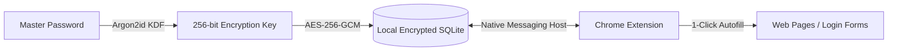

<pre>
                      ██╗   ██╗
                      ██║   ██║
                      ██║   ██║
                      ╚██╗ ██╔╝
                       ╚████╔╝ 
                        ╚═══╝  

   ██╗   ██╗ █████╗ ██╗   ██╗██╗  ████████╗██╗   ██╗
   ██║   ██║██╔══██╗██║   ██║██║  ╚══██╔══╝╚██╗ ██╔╝
   ██║   ██║███████║██║   ██║██║     ██║    ╚████╔╝ 
   ╚██╗ ██╔╝██╔══██║██║   ██║██║     ██║     ╚██╔╝  
    ╚████╔╝ ██║  ██║╚██████╔╝███████╗██║      ██║   
     ╚═══╝  ╚═╝  ╚═╝ ╚═════╝ ╚══════╝╚═╝      ╚═╝   
</pre>

### 🛡️ Next-Gen Zero-Knowledge Password Manager & Smart Autofill

---

**Vaulty** is a lightning-fast, privacy-first personal password manager built with **Tauri v2**, **Rust**, **React 19**, and a dedicated **Google Chrome Manifest V3 Companion Extension**.

---
> [!WARNING]
> ### ⚠️ Important Notes
> 1. **Windows SmartScreen**: The executable is currently unsigned. If prompted by SmartScreen, click **"More info" ➔ "Run anyway"**.
> 2. **Integrity Verification**: Official SHA-256 checksums are published with every [Release](https://github.com) to verify file integrity.
> 3. **Chrome Web Store Status**: The Chrome companion extension is currently **under review** by the Google Web Store team and will be publicly available shortly.

---

## ✨ Features at a Glance

- 🔒 **Zero-Knowledge Architecture**: All credentials are encrypted locally before touching storage. Your Master Password never leaves your machine.
- ⚡ **Intelligent Autofill & 1-Click Login**: Automatically recognizes login, registration, and password change fields across any website.
- 🧩 **Chrome MV3 Companion Extension**: Seamless communication with the desktop app through high-security local Native Messaging.
- 🎨 **Liquid Glass & Bento Grid UI**: Modern, fluid interface with customizable dynamic color themes (Cyber Violet, Ocean Blue, Emerald Nature, Pop Fuchsia).
- 🕒 **Integrated 2FA / TOTP Authenticator**: Generates standard time-based one-time passwords directly in-app and in the browser popup.
- 🔍 **HaveIBeenPwned Breach Check**: Checks if passwords have been compromised using a privacy-preserving 5-character SHA-1 k-anonymity model.

---

## 🔐 Security Architecture

- **Key Derivation (KDF)**: `Argon2id` with 64 MB memory cost, 3 iterations, and 4 lanes.
- **Cipher**: `AES-256-GCM` with 96-bit unique nonces and 128-bit authentication tags.
- **RAM Protection**: Explicit memory zeroization via Rust's `zeroize` crate to prevent secrets from lingering in memory.

---

## 📥 Installation & Setup

### Step 1: Install Vaulty Desktop
1. Download the latest **`Vaulty-Setup.exe`** from the [Releases](https://github.com) section.
2. Run the installer and follow the quick on-screen setup.
3. Launch **Vaulty** and create your secure Master Password.

### Step 2: Install Chrome Companion Extension
1. Install the **Vaulty Companion Extension** from the [Chrome Web Store](https://chrome.google.com/webstore).
2. The extension automatically establishes a secure Native Messaging bridge with the desktop app.
3. Press `Ctrl + Shift + L` on any login page to instantly fill your credentials!

---

## ⌨️ Useful Keyboard Shortcuts

| Shortcut | Action |
| :--- | :--- |
| `Ctrl + Shift + L` | Autofill credentials on current web page |
| `Ctrl + F` | Quick search vault items |
| `Ctrl + L` | Instantly lock vault |

---

Made with ❤️ by **ZeroState** • Built with Tauri v2 & Rust

